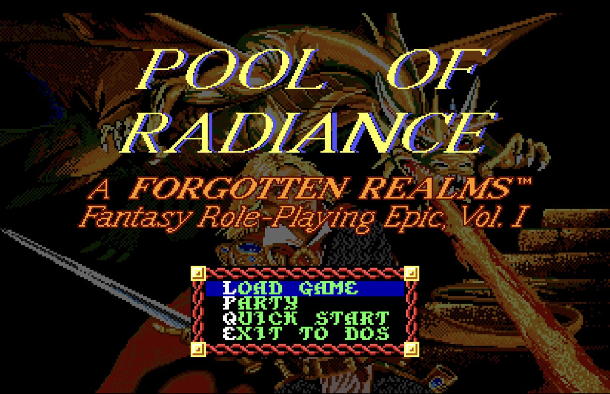
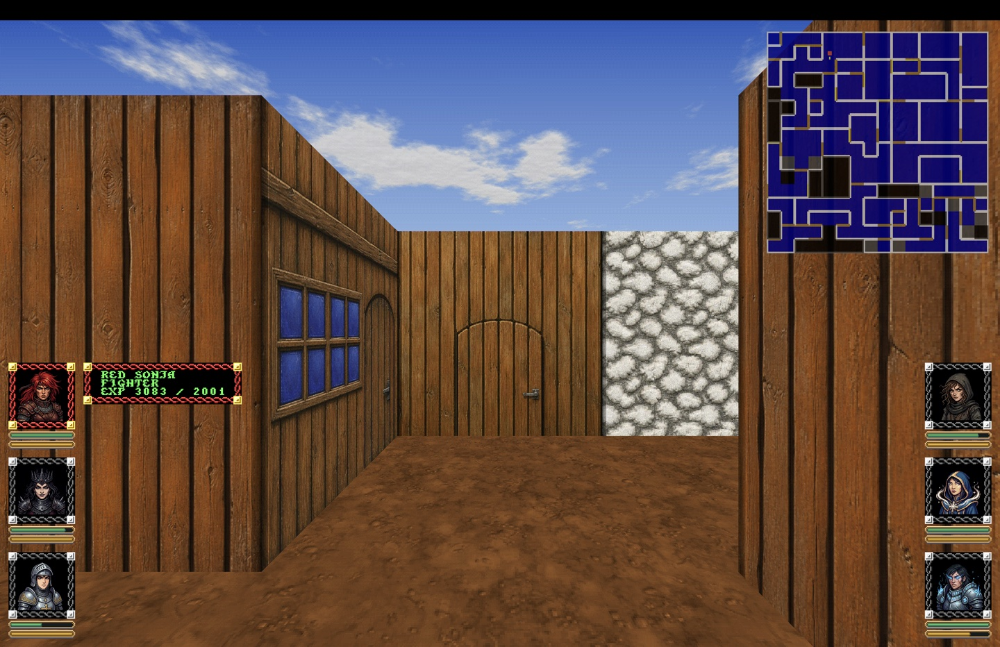
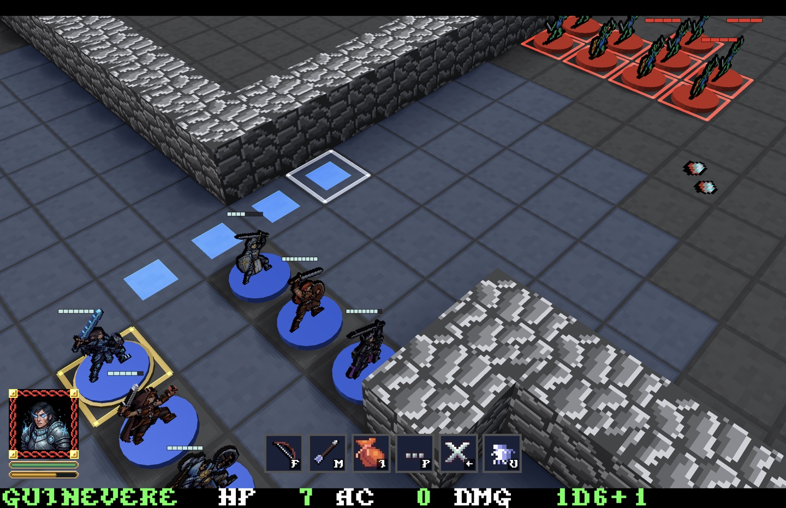
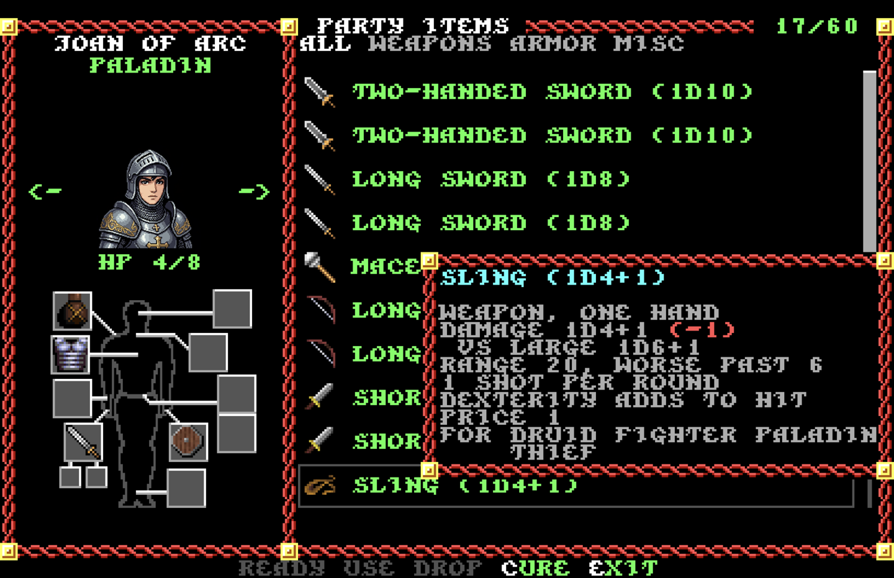

# Opinionated Pool

A Go port of *Pool of Radiance* (SSI, 1988) with a modernized interface
and a few opinions of its own about the rules (repository `por-go`).
`MODERNIZED.md` describes everything the port changes from the original
(the 3D views, the voice-over, the interface) and how to do it again for
another Gold Box game; `PORT_CHECKLIST.md` lists each change with its code.

## What's new for players

The areas, scripts and story are the 1988 original's, and so are most of
the rules. Some we changed on purpose where the original got in the way:
encumbrance is gone (only armour slows you), the party shares one pack and
one purse, Search and Look take three minutes instead of ten, and paladins
and rangers come from the sequel. The rest is how it looks and how it
feels to play:

- **A real 3D dungeon view.** Phlan's streets, sewers, castles and caves
  are rendered in first person with new wall art, water, sky, day and
  night, smooth steps and turns. The minimap sits in the corner, a full
  map is a key away, and you can click a square on it to walk there.
- **Tabletop battles.** Fights happen on a 3D board with figures on
  pedestals: click a square to walk, click a foe to attack, hover to see
  your chance to hit, and the action bar shows what you can do, with a
  tooltip on each weapon telling its range and rules.
- **Full voice-over.** Every line of the story, from the Council's
  proclamations to the tavern tales, is spoken.
- **Mouse and gamepad everywhere.** Every menu takes a click, the wheel
  scrolls, the right button backs out, a held key walks on.
- **A party inventory with icons.** One shared pack for the whole party,
  no weight or encumbrance; each member has a paper doll to equip. Pick a
  stack up with a click and drop it where it goes, split stacks with the
  right button, drag and drop works too. Tooltips compare an item with
  what you have readied.
- **One purse.** Gold, gems and jewelry belong to the party; shops,
  temples and training just take their price.
- **Named save slots** anywhere outside combat, and a note when the save
  is done.
- **Camp made simple.** Memorize is one screen that remembers your
  plan for every rest; the rest menu heals, waits an hour or until night
  or day.
- **The journal built in.** When the text points you at a journal entry
  or a tale, it opens on the spot, with the printed maps and sketches.
- **Your own portraits.** Drop a PNG on the character sheet and that face
  follows the character everywhere.
- **Quickstart party.** Six ready-made characters get you into Phlan in
  a minute; paladins and rangers are playable.
- **Amiga art and music** from the Amiga disks, if you have them, and a
  choice of fonts and a resizable, fullscreen-capable window.

## Video

## Screenshots

No game data is included. The engine reads the original game files (the
`.DAX` files, `ITEMS`) from your own copy of the game at run time. The rule
tables of `START.EXE` (races, classes, experience, spells ...) live in
`engine/tables.go`.

To set up a release: run `gameimport` in the folder beside `por` and pick
your copy of the game (its folder, a zip, a CD image or the GOG installer).
It copies the files `por` reads into `data/`, runs `por -setup` (which
writes the port's own files, the area scripts, into `data/assets/scripts`
and the cover picture), and optionally converts the Amiga disks' graphics and unpacks the voice-over (`por-voice.zip`) into `data/assets/speech`. `por` plays from `data/` in its working directory.

To build and play from the repo: put your game files in `data/dos` and run
`./build_n_run.sh` (it builds `./por`). The data folder:

| Folder | What | In git |
|---|---|---|
| `data/dos` | the DOS game files the engine reads (`*.DAX`, `ITEMS`, `POOL.CFG`) | no |
| `data/amiga` | the Amiga graphics and sound, converted from its disks (`por -import-disk2`) | no |
| `data/assets/scripts` | the area event scripts as text, with their names files | yes |
| `data/assets/fonts`, `data/assets/speech` | extra fonts (`*.f8`), the voice-over (`*.mp3`) | no |
| `data/save` | the saves, `FONT.CFG` (written by the game) | no |

`original/` (not in git) keeps the rest of the DOS install, which the
engine never reads: `START.EXE`, `GAME.OVR`, the DOS graphics the Amiga
files replace in full, ... The decompilation tools (`decomp/`, `exe`,
`cmd/sounddata`) use it.

The 8x8 fonts in `engine/fonts` are from The Ultimate Oldschool PC Font Pack
by VileR; see `engine/fonts/LICENSE.txt`.
